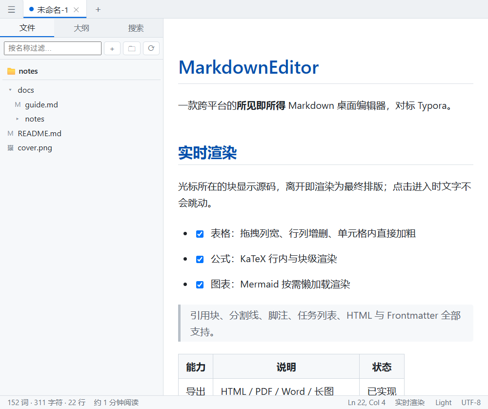
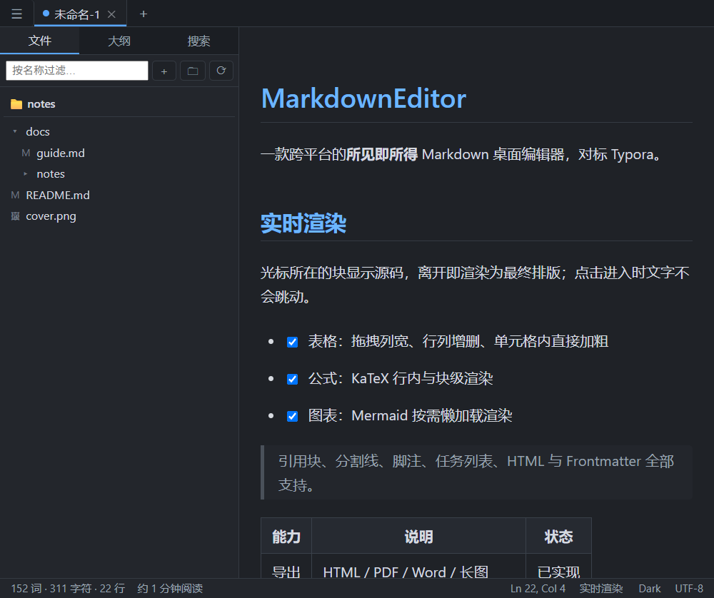
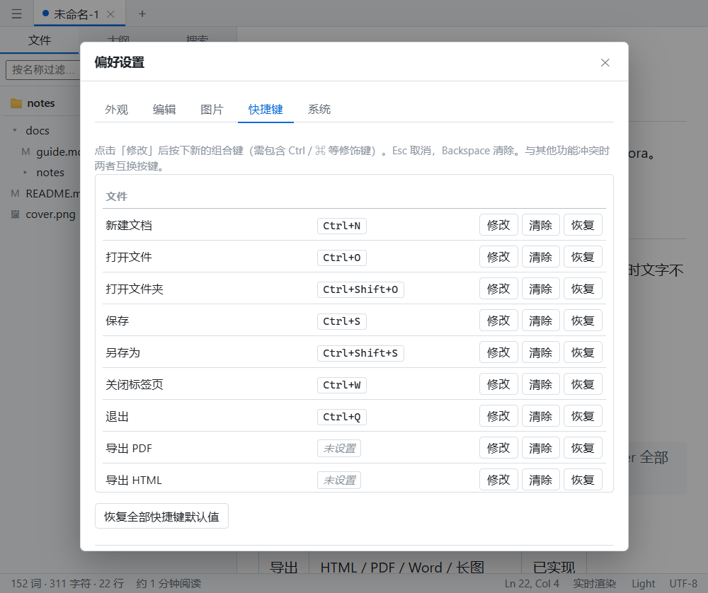

<div align="center">


# MarkdownEditor

**跨平台所见即所得（Typora 式）的 Markdown 桌面编辑器**

光标所在的块显示源码，离开即渲染为最终排版 —— 点击、输入、滚动都不会让文字跳动。

[](https://www.electronjs.org/)
[](https://vuejs.org/)
[](https://www.typescriptlang.org/)
[](https://codemirror.net/)
[](https://vite.dev/)
[](LICENSE)

[功能](#功能) · [截图](#截图) · [快速开始](#快速开始) · [打包与分发](#打包与分发) · [架构](#架构) · [开发](#开发指南) · [快捷键](#快捷键)

</div>

---

## 特性

| | 能力 |
| --- | --- |
| ✍️ **实时渲染** | 段落、标题、列表、任务列表、引用、表格、代码块、公式、图表、分割线、脚注、HTML、Frontmatter 全部即时渲染 |
| 🖱️ **点击不跳动** | 活动块的源码态与渲染态保持同一套排版度量，切换时文字纹丝不动（与 Typora 一致的观感） |
| 📄 **表格 WYSIWYG** | 拖拽列宽、行列增删与移动、对齐、TSV 粘贴建表；单元格内可直接选中文字按 `Ctrl+B` 加粗；列宽按文档持久化 |
| 🧩 **扩展能力** | 4 套内置主题 + 用户自定义主题目录、快捷键录制与冲突互换、偏好设置五页（外观 / 编辑 / 图片 / 快捷键 / 系统） |
| 📤 **导出** | 单文件 HTML、PDF（Chromium 打印、中文字体子集内嵌）、Word（内置生成器，无需 Pandoc）、长图 PNG、复制为富文本 |
| 🖼️ **图片** | 粘贴 / 拖拽插入，三种存储策略，网络图片一键本地化，通用 multipart 图床批量上传 |
| 🗂️ **工作区** | 文件夹侧边栏（新建、重命名、回收站删除、拖拽移动）、大纲视图、全局搜索、分屏编辑 |
| 🛡️ **安全基线** | `contextIsolation` + `sandbox` 开启、`nodeIntegration` 关闭、preload 白名单 API、渲染内容经 DOMPurify 消毒、自定义主题仅接受受限 CSS 变量 |
| 🌍 **国际化** | 简体中文 / English，默认跟随系统；Windows / macOS / Linux 三平台 |

## 截图

**实时渲染（浅色）**



**深色主题**



**快捷键自定义（偏好设置 → 快捷键）**



## 功能

> 编号对应产品需求文档（PRD）的条目编号，便于逐条核对。

### 编辑器核心

| 编号 | 功能 | 状态 |
| --- | --- | --- |
| E-01 | 实时渲染模式（光标所在块显源码，离开即渲染） | ✅ 标题/段落/列表/任务列表/引用/表格/代码块/公式/分割线/脚注/HTML/Frontmatter；**活动块保持与渲染态一致的排版度量，点击进入时文字不跳动** |
| E-02 | 源码 / 预览 / 实时三模式 | ✅ `Ctrl+/` 循环，状态栏可点击切换 |
| E-03 | 标题 1–6 级 | ✅ `Ctrl+1` ~ `Ctrl+6` |
| E-04 | 列表 | ✅ 有序/无序/任务列表（复选框可直接点击勾选并回写源码）、回车续项、Tab/Shift+Tab 升降级 |
| E-05 | 表格 | ✅ 拖拽列边界调整列宽（手柄 + 实时预览，列宽为展示层状态不写入源码、**按文档持久化**）、行列增删、行列上下/左右移动、对齐方式（左/中/右，回写 `:---:` 标记）、`Ctrl+T` 插入、Excel/网页 TSV 粘贴生成表格、宽表横向滚动、单元格点击精确定位到源码、**渲染态单元格内可选中文本并用 `Ctrl+B` 等快捷键加粗/斜体** |
| E-06 | 代码块 | ✅ 语言标注 + highlight.js 高亮 + **语言下拉切换**（即时回写源码）+ 一键复制 |
| E-07 | 数学公式 | ✅ KaTeX 行内/块级实时渲染 |
| E-08 | Mermaid 图表 | ✅ 按需懒加载渲染，语法错误有兜底提示；**导出时同样渲染成图**（HTML/PDF/长图为 SVG，Word 内嵌 PNG） |
| E-09 | 图片 | ✅ 粘贴/拖拽插入；三种存储模式（`./assets` / 全局目录 / 仅引用原路径）；文件名规则与重名去重；**支持 Windows 绝对路径**（`D:\dir\img.png`）；**网络图片可一键本地化**（⬇ 按钮，下载后回写为本地路径）；加载失败显示占位提示 |
| E-10 | 链接 | ✅ `Ctrl/Cmd+点击` 用系统浏览器打开；相对 `.md` 链接可跳转打开 |
| E-11 | 引用块/分割线/脚注/高亮 `==`/上下标 | ✅ |
| E-12 | 撤销/重做 | ✅ CodeMirror 完整历史，跨标签页保留 |
| E-13 | 查找替换 | ✅ `Ctrl+F` / `Ctrl+H`，正则/大小写/全词 |
| E-14 | 字数统计 | ✅ 字符/词/行/预计阅读时长，中文按字计 |
| E-15 | 拼写检查 | ✅ Chromium 内置词典（可开关、选 en-US/en-GB/en-CA/en-AU；仅拉丁语系，中文不标记） |
| E-16 | 智能排版 | ✅ 括号引号自动配对、选中文本粘贴 URL 自动成链接 |
| E-17 | IME 中文输入兼容 | ✅ 组合输入期间不触发重排（活动块判定天然覆盖 composition） |

### 文件与文档管理

| 编号 | 功能 | 状态 |
| --- | --- | --- |
| F-01 | 新建/打开/保存/另存为 | ✅ |
| F-02 | 自动保存 | ✅ 定时（默认 30s）+ 失焦保存；**崩溃快照恢复**（有未保存改动时定期写快照，下次启动可恢复） |
| F-03 | 未保存标识与关闭确认 | ✅ 标签页圆点 + 关闭/退出弹窗（保存/丢弃/取消） |
| F-04 | 标签页多文档 | ✅ 多开、拖拽排序、右键关闭其他/右侧、`Ctrl+Tab` 切换 |
| F-05 | 最近打开 | ✅ 菜单 + 欢迎页展示，可清空 |
| F-06 | 文件夹工作区侧边栏 | ✅ 打开文件夹 → 文件树（新建/重命名/删除到回收站/拖拽移动、右键菜单、`.md` 与图片高亮、名称过滤、工作区路径持久化） |
| F-07 | 外部变更检测 | ✅ 提示「重新加载 / 保留我的编辑」，自有写入自动抑制 |
| F-08 | 大纲视图 | ✅ 标题树、点击跳转、当前位置高亮 |
| F-09 | 全局搜索 | ✅ 按文件名 / 按内容搜索，结果点击打开并定位到行 |

### 界面与体验

| 编号 | 功能 | 状态 |
| --- | --- | --- |
| U-01 | 三栏布局 / 专注模式 | ✅ 可折叠侧边栏（文件/大纲/搜索三视图）+ 编辑区；专注模式隐藏侧栏与标签栏；打字机模式（光标行垂直居中） |
| U-02 | 主题系统 | ✅ **4 套内置主题**（浅色 / 暖纸 / 深色 / 深紫）+ **用户自定义主题目录**（`<userData>/themes/*.css`，只接受 `:root` 下的 `--变量`，值受限不会加载外部资源）；CSS Variables 实现，导出 HTML/长图跟随当前主题 |
| U-03 | 跟随系统明暗 | ✅ |
| U-04 | 字体与排版设置 | ✅ 正文字体/等宽字体/字号（滑块+数字框，实时预览）/行高/内容最大宽度 |
| U-05 | 原生菜单与快捷键 | ✅ 中英文菜单、macOS 适配、状态栏可切模式与主题；**快捷键可自定义**（偏好设置 → 快捷键：录制组合键、冲突时两两互换、单条/全部恢复默认）；菜单、窗口与编辑器共用同一张快捷键表 |
| U-06 | 状态栏 | ✅ 字数/词数/行数/阅读时长/行列号/模式/主题/文件编码 |
| U-07 | 欢迎页 | ✅ |
| U-08 | 多语言 i18n | ✅ 简体中文 / English，菜单与界面双语，默认跟随系统 |
| U-09 | 无边框窗口与自定义标题栏 | ✅ 左侧 logo + 原生弹出菜单、中部当前文档名、右侧最小化 / 最大化 / 关闭；Windows 11 原生圆角、四边四角拉伸、双击标题栏切换最大化，深色主题图标自动反色 |
| U-10 | 右键上下文菜单 | ✅ 编辑器（撤销/剪贴板、插入、段落、格式、表格、链接、图片复制/另存/定位、代码）、标签页、文件树、标题栏与预览模式；子菜单、快捷键提示、勾选状态、键盘导航与视口边缘翻转 |

### 系统集成

| 编号 | 功能 | 状态 |
| --- | --- | --- |
| S-01 | 文件关联 | ✅ 安装包注册 `.md/.markdown/.mkd/.mdown/.txt`（带 logo 图标） |
| S-02 | 拖拽打开文件 | ✅ |
| S-03 | 命令行启动 `MarkdownEditor file.md` | ✅ 传入文件夹则直接打开为工作区 |
| S-04 | 单实例锁 | ✅ 重复启动聚焦已有窗口并打开新文件 |
| S-05 | 自动更新 | ✅ 基于 electron-updater 的通用更新源（偏好设置里填地址，或 `MDE_UPDATE_URL`），后台下载、重启安装；菜单「帮助 → 检查更新」 |
| S-06 | 托盘 | ✅ 托盘图标（显示窗口 / 新建文档 / 退出），可设置「关闭窗口时最小化到托盘」 |

### 导出

| 编号 | 功能 | 状态 |
| --- | --- | --- |
| X-01 | 导出 HTML | ✅ 单文件 HTML：主题 CSS（含用户主题变量）内联、本地图片转 base64 内嵌、KaTeX 公式与代码高亮、Mermaid 图一并导出 |
| X-02 | 导出 PDF | ✅ Chromium 打印管线，A4/A3/Letter/Legal、横竖版、页边距、缩放、页码页脚；**中文字体自动子集嵌入** |
| X-03 | 导出 Word (.docx) | ✅ 内置生成器（无需 Pandoc）：标题/加粗/斜体/删除线/行内代码/超链接/列表/引用/代码块/表格，Mermaid 图以 PNG 内嵌 |
| X-04 | 导出图片（长图） | ✅ 隐藏窗口分段截取并拼接为一张 PNG（可选宽度 / 倍率 / 背景，超长文档拆成 `name-partN.png`） |
| X-05 | 复制为富文本 / HTML | ✅ 「编辑 → 复制为富文本」：图片内嵌为 base64，同时写入 HTML 与纯文本，可直接粘贴到 Word / 飞书 |
| X-06 | 图片上传图床 | ✅ 通用 multipart 上传接口（地址 / 字段名 / 请求头 / 响应字段路径），「文件 → 上传图片到图床」批量上传文档中的本地图片并替换引用 |

> **关于 PDF 中的中文**：PDF 由 Chromium 打印生成，会把实际用到的字体**子集化嵌入**
> （实测生成的文件内含 `MicrosoftYaHei` / `NSimSun` 等 6 个 `FontFile2` 子集与
> `Identity-H` CMap，文本可选可复制）。因此导出机器上需装有中文字体
> （Windows 自带微软雅黑 / 苹方 / Noto Sans CJK 均可）。
> 另注意 Electron 的 `printToPDF` 页边距单位是**英寸**（对话框用 px，内部换算）。

## 快速开始

```bash
# 依赖（先配置淘宝镜像）
npm install

# 开发模式（Electron + 渲染层 HMR）
npm run dev

# 生产构建，产物在 out/
npm run build

# 预览生产构建
npm run preview
```

> **Electron 二进制下载失败？** 手动执行一次：
>
> ```bash
> $env:ELECTRON_MIRROR='https://npmmirror.com/mirrors/electron/'
> node node_modules/electron/install.js
> ```

## 打包与分发

| 平台 | 目标 | 产物 |
| --- | --- | --- |
| Windows x64 | NSIS | `MarkdownEditor-<version>-setup.exe`（含 `.md` 文件关联） |
| macOS x64 / arm64 | DMG + ZIP | `.dmg`（拖拽安装）、`.zip`（**自动更新需要 zip**） |
| Linux x64 | AppImage + deb | `.AppImage`、`.deb`（桌面项已注册 `text/markdown`） |

```bash
npm run dist:win     # Windows（必须在 Windows 上执行）
npm run dist:mac     # macOS（必须在 macOS 上执行，产出 x64 + arm64）
npm run dist:linux   # Linux（必须在 Linux 上执行）
```

> **跨平台限制**：electron-builder 不支持在 Windows 上产出 macOS 包（反之亦然）。
> 三平台产物由 GitHub Actions 的 `.github/workflows/release.yml` 构建：
> 推送 `v*` 标签即可得到安装包并自动创建 Release；手动触发（workflow_dispatch）只出产物。

### 代码签名与公证

签名与公证通过环境变量传入，缺少变量时构建会**跳过签名**（不会失败）：

| 变量 | 用途 |
| --- | --- |
| `CSC_LINK` / `CSC_KEY_PASSWORD` | 签名证书（p12 的 base64 或 `file://` 路径），Windows 与 macOS 通用 |
| `APPLE_ID` / `APPLE_APP_SPECIFIC_PASSWORD` / `APPLE_TEAM_ID` | macOS 公证（Apple ID + app 专用密码 + 团队 ID） |
| `APPLE_API_KEY` / `APPLE_API_KEY_ID` / `APPLE_ISSUER` | macOS 公证（API Key 方式，与上面二选一） |

macOS 使用 **hardened runtime** 与 `resources/entitlements.mac.plist`（JIT、用户选中的文件读写、网络客户端），
公证由 electron-builder 自动完成（`@electron/notarize`）。

CI 需要的仓库密钥见 `.github/workflows/release.yml` 顶部注释：证书以 base64 形式放进
`MAC_CERT_P12` / `WIN_CERT_P12`，工作流会导入钥匙串 / 证书库后再构建。

### 自动更新的更新源

`electron-builder.yml` 里 `publish: null`（不内置更新源），更新地址二选一：

- 偏好设置 →「系统 → 更新源地址」，或环境变量 `MDE_UPDATE_URL`（通用 provider，需要一个能列目录的静态服务器）；
- 打包时指定 GitHub provider：`--config.publish.provider=github`（electron-updater 会用 GitHub API 拉取版本）。

### 打包常见问题

Windows 打包偶发 `EBUSY: resource busy or locked, unlink '.../default_app.asar'`（被杀毒软件或占用中的程序锁住）：

1. 打包时不要用其它 Markdown 编辑器打开同目录下的文件；
2. 项目根目录 `.vscode/settings.json` 中把 `release/**`、`out/**`、`node_modules/**` 排除出文件监听与搜索；
3. 清掉残留后重新打包：`npm run clean:release && npm run dist:win`；
4. 若仍失败，可用已解压的 Electron 目录打包，跳过解压步骤：

```powershell
npx electron-builder --win --config electron-builder.yml `
  --config.electronDist=node_modules/electron/dist `
  --config.directories.output=release-v3
```

### 应用图标

| 位置 | 来源 |
| --- | --- |
| 任务栏 / 窗口图标 | `BrowserWindow.icon` → 开发态 `resources/icon.png`，打包态 `<resources>/icon.png`（由 `extraResources` 拷贝） |
| 桌面快捷方式 / 开始菜单 | NSIS 安装器图标（`nsis.installerIcon` / `uninstallerIcon` / `installerHeaderIcon`） |
| 程序 exe 图标 | `win.icon: resources/icon.ico`（16–256 多分辨率，由 `resources/logo.png` 转换） |
| 应用左上角 / 欢迎页 | 渲染层 `src/assets/icon.png`（由 2048px 原图缩放到 256px） |

## 架构

```
MarkdownEditor/
├── electron/                 # 主进程 + 预加载
│   ├── main/
│   │   ├── index.ts          # 窗口、生命周期、单实例锁、安全基线、托盘接线
│   │   ├── menu.ts           # 原生菜单（中英双语、模式单选、最近文件、快捷键加速键）
│   │   ├── ipc.ts            # 全部 IPC handler（文件/设置/图片/工作区/剪贴板/生命周期）
│   │   ├── fileStore.ts      # 最近文件与设置的原子化持久化
│   │   ├── fileIo.ts         # 文本文件读写（编码探测与原编码写回）
│   │   ├── encoding.ts       # UTF-8 / UTF-16 / GB18030 / windows-1252 编码探测
│   │   ├── watcher.ts        # chokidar 外部变更监听（抑制自有写入）
│   │   ├── workspace.ts      # 工作区目录树、条目增删改、全局搜索
│   │   ├── export.ts         # HTML / PDF / Word / 长图导出
│   │   ├── userThemes.ts     # 用户主题目录（读取、示例、映射原生主题族）
│   │   ├── imageHost.ts      # 图床 multipart 上传
│   │   ├── tableLayout.ts    # 表格列宽持久化
│   │   ├── tray.ts           # 托盘图标与「关闭到托盘」
│   │   ├── updater.ts        # 自动更新（electron-updater）
│   │   └── protocol.ts       # mdimg:// 本地图片协议
│   └── preload/index.ts      # contextBridge 白名单 API（window.api）
├── shared/                   # 主进程/预加载/渲染进程共享的类型、快捷键表、主题解析、i18n 词典
├── src/                      # 渲染进程（Vue 3）
│   ├── components/           # EditorHost / TabsBar / StatusBar / WelcomeScreen / SettingsDialog / Sidebar / FileTree / OutlineView / SearchPanel / TableToolbar / PreviewPane / Modal
│   ├── editor/
│   │   ├── extensions/       # liveRender（实时渲染内核）/ keymaps / images
│   │   ├── markdown/         # render（markdown-it 管线）/ mermaid
│   │   ├── export/           # html（自包含 HTML）/ docx（Word 生成器）/ mermaid
│   │   ├── segmenter.ts      # 区块分割器（实时渲染的基础）
│   │   ├── sourceStyle.ts    # 源码态与渲染态的排版度量对齐
│   │   ├── textMap.ts        # 可见文本 ↔ 源码位置映射
│   │   ├── tables.ts         # 表格解析与行列操作
│   │   ├── outline.ts        # 大纲提取
│   │   ├── imageRefs.ts      # 文档中的图片引用（图床上传用）
│   │   ├── config.ts         # 扩展装配 + 模式 compartment
│   │   └── statePool.ts      # 每标签页的 EditorState 池
│   ├── lib/                  # i18n / 快捷键匹配 / 用户主题注入 / 事件总线 / 浏览器 mock API
│   ├── stores/               # Pinia：documents / settings / workspace
│   └── themes/index.css      # 主题变量与全部界面样式
├── .github/workflows/        # 三平台构建 / 签名 / 公证 / Release
└── docs/                     # 验收样例文档与截图
```

### 实时渲染内核怎么工作

1. `segmenter.ts` 把文档切分为顶层区块（标题/段落/列表项/引用/表格/代码/公式…），纯函数、可单测。
2. `liveRender.ts` 通过 `EditorView.decorations.compute` 生成装饰集：
   **不包含光标/选区的区块被替换为渲染部件**（`Decoration.replace({block:true})`），
   活动区块保持源码。
3. 渲染部件同时注册进 `EditorView.atomicRanges`，光标不会落进被隐藏的文本；
   IME 组合输入时选区一定在活动区块内，因此不会吞字或误重排。
4. 渲染管线为 `markdown-it + KaTeX + highlight.js + DOMPurify`，
   相对图片路径经 `mdimg://` 协议解析到**文档所在目录**，源码里仍是可移植的相对路径。

> **点击不跳动**：块在「渲染态 ↔ 源码态」之间切换时，两种形态的排版度量必须一致，
> 否则光标所在块的高度一变，上下文就会整体位移（Typora 就没有这个问题）。
> 因此活动块的源码行会继承渲染态的字号、行高、上下边距与缩进，
> 块标记（`# `、`- `、`> `）在源码态被替换掉（列表用项目符号占位），
> 标题在源码态仍然是标题的字号与颜色。无法完全对齐的块（代码块、公式、图片）
> 另有滚动锚定补偿，保证点击位置不漂移。

> 踩坑记录：CodeMirror 6 **不允许**通过 ViewPlugin 提供块级装饰（`Block decorations may not be
> specified via plugins`），必须走 `EditorView.decorations` facet；同时 `.cm-content` 的
> `white-space: pre-wrap` 会让 markdown-it 输出中的换行变成真实换行，部件内需重置为 `normal`。

### 表格编辑（E-05）怎么工作

- `tables.ts` 解析表格源码 → 单元格在文档中的精确偏移，因此点击渲染后的单元格能把光标
  精确放进源码对应的位置，行列增删/移动/对齐都是对源码的一次性改写（单次撤销）。
- 表格在实时模式下**常驻渲染**（光标进入表格也不回退成源码），否则拖拽手柄会立刻消失；
  活动单元格显示原始 Markdown 并带焦点框与伪光标。
- 列宽是**展示层状态**（`tableLayout.ts`，按文档 + 表格标识保存），不会写进 Markdown 文件，
  但会按文件路径持久化到 `userData/table-layout.json`，重启后仍然保留；
  表格用 `table-layout: fixed` + `<colgroup>` 精确生效，超出编辑区宽度时横向滚动。
- 光标位于表格内时，编辑器上方浮出表格工具栏（增删行列、上下左右移动、对齐、重置列宽）。
- 粘贴带制表符的文本（Excel/网页）会自动转换为 Markdown 表格。

### 侧边栏工作区

- 侧边栏有 **文件 / 大纲 / 搜索** 三个视图，可折叠（`Ctrl+Shift+B`），专注模式（`Ctrl+Shift+F`）
  会隐藏侧栏与标签栏，打字机模式让光标行始终垂直居中。
- **文件树**：主进程扫描目录（忽略 `node_modules`/`.git`/隐藏目录，限制深度与条目数），
  支持新建文件/文件夹、重命名、删除（进系统回收站）、拖拽移动；`.md` 与图片有独立图标，
  顶部输入框可按名称过滤（目录在子项命中时保留）。
- **大纲**：从当前文档解析 ATX 标题，层级缩进，点击跳转并滚动到视口中央，
  光标所在位置的标题高亮。
- **搜索**：按文件名或按内容搜索整个工作区（主进程执行，限制文件数/体积/结果数），
  点击结果打开对应文件并定位到匹配行。
- 工作区路径会持久化，重启后自动恢复；也可以用命令行直接打开工作区：
  `MarkdownEditor <文件夹路径>`。

### 导出 / 分屏 / 崩溃恢复

- **导出**：菜单「文件 → 导出 → PDF / HTML / Word」，或设置里没有入口但状态栏可触发。
  - HTML：单文件，主题 CSS 内联、本地图片转 base64 内嵌，可直接分享。
  - PDF：隐藏窗口用 Chromium 打印，A4/A3/Letter/Legal、横竖版、四边页边距、缩放、页码页脚；
    **中文字体自动子集嵌入**，文本可选可复制。
  - Word：内置 `.docx` 生成器（不依赖 Pandoc），支持标题、加粗/斜体/删除线、行内代码、
    超链接、有序/无序列表、引用、代码块与表格。
- **分屏编辑**：「查看 → 分屏编辑」。左栏跟随标签页，右栏在顶栏下拉里选择另一个文档；
  两栏各自独立编辑，右栏不会抢走标签页的活动文档。
- **崩溃快照恢复**：文档存在未保存改动时，每 4 秒把内容快照写入 `userData/snapshots`
  （独立于原文件，不会损坏源文件）；下次启动若检测到快照会询问是否恢复，
  文档保存后快照自动清理。

### 快捷键 / 自定义主题 / 托盘与更新

- **快捷键**：`shared/keymap.ts` 是唯一的快捷键表（菜单 / 窗口 / 编辑器三种作用域），
  原生菜单、窗口键盘处理与 CodeMirror 命令都从这张表解析，所以改一次三处同时生效。
  偏好设置里可以录制新的组合键；与已有快捷键冲突时两个功能互换按键；
  录制期间会临时摘掉菜单加速键，避免按键被菜单吃掉。
- **自定义主题**：主题文件夹里的每个 `.css` 文件就是一个主题，文件头用 `name:` / `base:` 声明
  名称与基础主题（`light` / `dark`），正文只写 `:root` 下的 `--变量`。
  为了安全，解析器只接受**受限的变量值**（拒绝 `url()`、`@import`、转义、`<`、`>` 等），
  因此主题可以改颜色和间距，但无法加载外部资源或注入标记；导出 HTML / 长图时同样只嵌入这些变量。
- **托盘与更新**：托盘图标提供「显示窗口 / 新建文档 / 退出」，可设置关闭窗口时隐藏到托盘；
  自动更新使用 electron-updater 的通用更新源（偏好设置里填地址或 `MDE_UPDATE_URL`），
  检查到新版本会在后台下载，下次启动时安装。

## 快捷键

| 功能 | Windows / Linux | macOS |
| --- | --- | --- |
| 新建 / 打开 / 保存 | `Ctrl+N` / `Ctrl+O` / `Ctrl+S` | `Cmd+N` / `Cmd+O` / `Cmd+S` |
| 另存为 | `Ctrl+Shift+S` | `Cmd+Shift+S` |
| 查找 / 替换 | `Ctrl+F` / `Ctrl+H` | `Cmd+F` / `Cmd+H` |
| 标题 1–6 | `Ctrl+1` ~ `Ctrl+6` | `Cmd+1` ~ `Cmd+6` |
| 加粗 / 斜体 / 行内代码 | `Ctrl+B` / `Ctrl+I` / `Ctrl+E` | 同 |
| 删除线 / 高亮 / 公式 | `Ctrl+Shift+X` / `Ctrl+Shift+H` / `Ctrl+Shift+M` | 同 |
| 插入链接 / 插入表格 | `Ctrl+K` / `Ctrl+T` | 同 |
| 切换三模式 | `Ctrl+/` | `Cmd+/` |
| 切换明暗主题 | `Ctrl+Shift+L` | `Cmd+Shift+L` |
| 侧边栏 | `Ctrl+Shift+B` | `Cmd+Shift+B` |
| 偏好设置 | `Ctrl+,` | `Cmd+,` |
| 专注模式 | `Ctrl+Shift+F` | `Cmd+Shift+F` |
| 切换标签页 | `Ctrl+Tab` / `Ctrl+Shift+Tab` | `Cmd+Tab` / `Cmd+Shift+Tab` |
| 关闭标签页 | `Ctrl+W` | `Cmd+W` |
| 复制为富文本 | `Ctrl+Shift+C` | `Cmd+Shift+C` |
| 列表升降级 | `Tab` / `Shift+Tab` | 同 |

> 以上快捷键**都可以在「偏好设置 → 快捷键」里改**：点击「修改」后直接按下新的组合键
> （Esc 取消、Backspace 清除）；如果新组合已被别的功能占用，两个功能会**互换按键**，
> 不会互相覆盖。菜单、窗口快捷键和编辑器命令共用同一张表，改完立即生效。

## 开发指南

| 命令 | 说明 |
| --- | --- |
| `npm run dev` | 开发模式（Electron + HMR） |
| `npm run build` | 生产构建（输出到 `out/`） |
| `npm run preview` | 预览生产构建 |
| `npm run check` | **提交前跑这个**：lint + format:check + typecheck + test |
| `npm run lint` / `npm run lint:fix` | ESLint 10（typescript-eslint + eslint-plugin-vue） |
| `npm run format` / `npm run format:check` | Prettier 3 |
| `npm run typecheck` | 主进程 / 预加载 / 渲染进程三套 `tsconfig`，全部 `strict` |
| `npm test` | Vitest（jsdom 环境） |

### 质量保障

- `npm test`：165 个 Vitest 用例，覆盖区块分割、CJK 字数统计、渲染管线消毒（XSS）、
  图片路径改写、KaTeX/任务列表/表格对齐、编辑命令（加粗包裹/解包、标题、表格插入）、
  快捷键解析与冲突互换、自定义主题解析与安全校验、图片引用查找、图床上传（本地 HTTP 服务）、
  文本映射（可见文本 ↔ 源码）、编码探测与 GBK 往返、表格列宽持久化、源码态排版度量对齐。
- 安全基线：`contextIsolation: true`、`sandbox: true`、`nodeIntegration: false`、
  CSP 限制、外链一律交给系统浏览器、渲染 HTML 经 DOMPurify 消毒、
  自定义主题只接受受限的 CSS 变量（不会加载外部资源）。

### 路线图

- ✅ **M1 骨架**：Electron + Vue 3 + TypeScript + Vite，窗口、菜单、IPC、协议、监听器、单实例。
- ✅ **M2 核心体验**：实时渲染、三模式、标签页、自动保存、查找替换、统计、主题、设置。
- ✅ **M3 工作区**：侧边栏文件树（新建/重命名/删除/拖拽移动）、大纲视图、全局搜索、打字机模式。
- ✅ **M4 打磨与导出**：表格 WYSIWYG、崩溃快照、分屏、导出 HTML/PDF/Word/长图、复制富文本、图床上传。
- ✅ **M5 发布**：快捷键自定义、自定义主题、托盘、自动更新、文件关联、三平台打包与签名配置、CI。

## 已知限制

- `docs/sample.md` 中的 `./assets/sample.png` 为占位路径，放入真实图片后即可验证本地图片显示。
- macOS / Linux 的安装包必须在对应系统上构建（本仓库已提供配置与 CI 流水线）。
- 自动更新需要一个更新源（通用 provider 的静态目录或 GitHub Releases），默认不内置。
- 非 UTF-8 文档目前只识别 GB18030（含 GBK/GB2312）、UTF-16 与 windows-1252；其它编码按 UTF-8 读取。
- 渲染态表格单元格里的选择按「可见文本 → 源码」近似映射，含复杂嵌套标记时定位可能有一两个字符的偏差。
- 源码态按源码行显示，多行段落（软换行）不会像渲染态那样合并成一行，
  因此这类段落被激活时高度会比渲染态略高。

## 许可证

[MIT](LICENSE) © MarkdownEditor contributors

## 致谢

- [CodeMirror 6](https://codemirror.net/) —— 编辑器内核与实时渲染的基础
- [markdown-it](https://github.com/markdown-it/markdown-it) 及插件生态 —— Markdown 解析
- [KaTeX](https://katex.org/) / [Mermaid](https://mermaid.js.org/) / [highlight.js](https://highlightjs.org/) —— 公式、图表与代码高亮
- [DOMPurify](https://github.com/cure53/DOMPurify) —— 渲染内容消毒
- [Electron](https://www.electronjs.org/) / [electron-builder](https://www.electron.build/) / [electron-updater](https://www.electron.build/electron-updater) —— 桌面壳、打包与自动更新

---

<div align="center">

**English**

A cross-platform WYSIWYG (Typora-style) Markdown desktop editor built with Electron, Vue 3, TypeScript and CodeMirror 6.
The block under the cursor shows its source and renders back to final typography when you leave it — and switching between
the two forms never makes the text jump. Tables, math, Mermaid diagrams, code blocks, images and footnotes are all
rendered live; documents can be exported to HTML, PDF, Word or a long image; themes and keyboard shortcuts are
customizable; and the whole thing ships for Windows, macOS and Linux with code signing and auto-update wired up.

MIT licensed.

</div>
