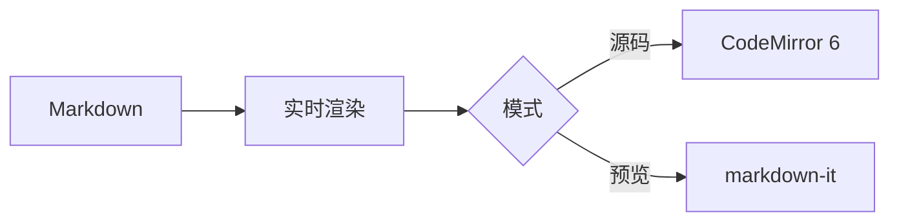

# MarkdownEditor 验收样例

本文档覆盖 PRD 验收清单中涉及的各类语法，可用于快速验证实时渲染效果。

## 基本排版

包含 **加粗**、*斜体*、~~删除线~~、`行内代码`、==高亮==、H~2~O 与 x^2^、以及 [Typora 官网](https://typora.io) 链接。

## 列表

- 无序列表项一
- 无序列表项二
  - 嵌套子项
- [x] 已完成的任务
- [ ] 未完成的任务

1. 有序列表项一
2. 有序列表项二

## 引用

> 这是一段引用。
> 第二行引用。

## 表格

| 功能 | 编号 | 状态 |
| :--- | :---: | ---: |
| 实时渲染 | E-01 | 已实现 |
| 查找替换 | E-13 | 已实现 |
| 表格拖拽列宽 | E-05 | 待实现 |

## 代码块

```js
function hello(name) {
  console.log(`Hello, ${name}!`)
}
```

```python
def fib(n):
    a, b = 0, 1
    for _ in range(n):
        a, b = b, a + b
    return a
```

## 数学公式

行内公式：$e^{i\pi} + 1 = 0$

块级公式：

$$
\int_0^\infty e^{-x^2}\,dx = \frac{\sqrt{\pi}}{2}
$$

## Mermaid 图表



## 图片


## 分隔线与脚注

---

脚注引用[^1]。

[^1]: 这是一条脚注的说明文字。
